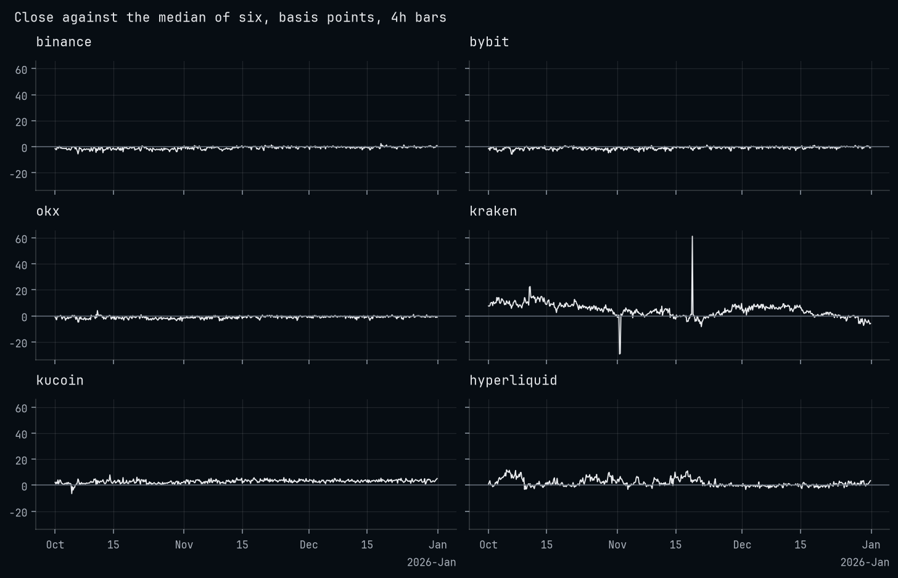
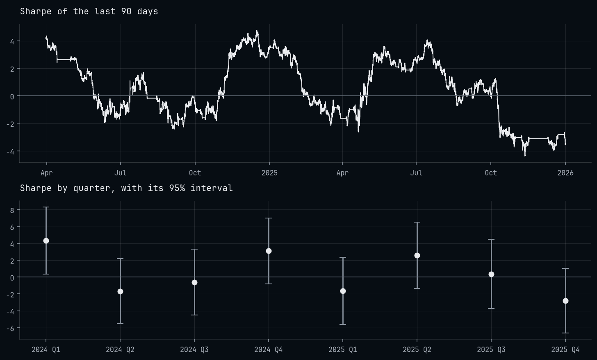
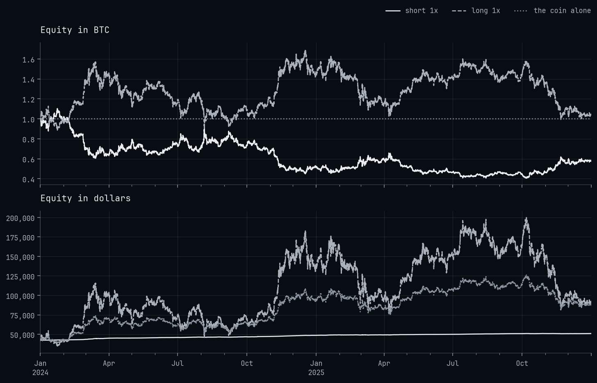
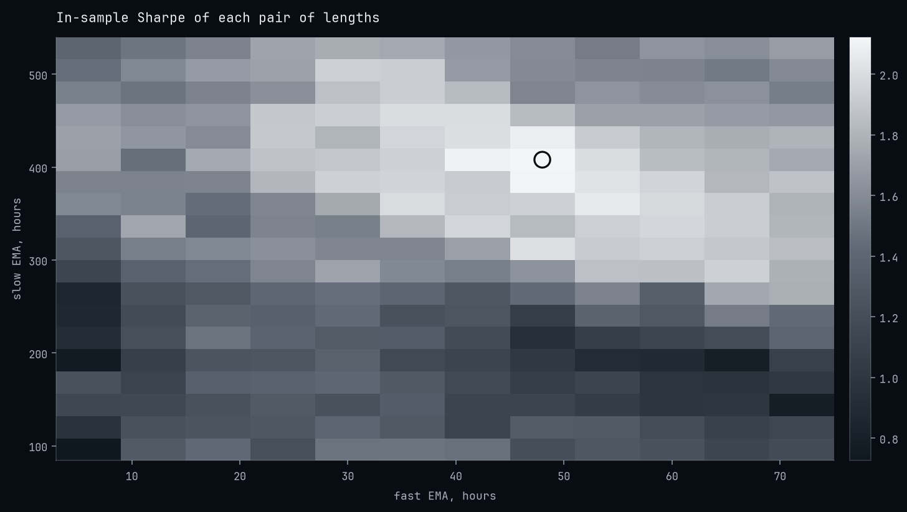
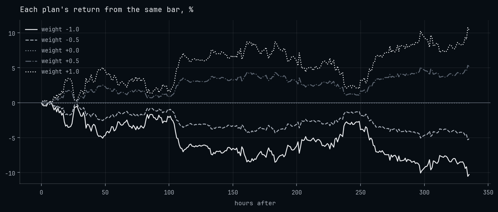

<h1>OCEΛNO <small><code>examples</code></small></h1>


<div style="padding-top: 0px;">
  <a href="https://www.python.org/downloads/"></a>
  <a href="https://github.com/atOCEANO/probatum/releases"></a>
  <a href="https://github.com/atOCEANO/exchange-router/releases"></a>
  <a href="https://opensource.org/licenses/MIT"></a>
</div>

<sub>
  <b>Introduction</b> &nbsp;•&nbsp;
  <a href="#data">Data</a> &nbsp;•&nbsp;
  <a href="#charts">Charts</a> &nbsp;•&nbsp;
  <a href="#strategies">Strategies</a> &nbsp;•&nbsp;
  <a href="#research">Research</a> &nbsp;•&nbsp;
  <a href="#reinforcement-learning">Reinforcement Learning</a>
</sub>

<br>
<br>
<br>
<br>

## Introduction

`examples` is **thirty notebooks that run exchange-router and probatum from end to end, from fetching bars at six exchanges to training an agent.** [exchange-router](https://github.com/atOCEANO/exchange-router) fetches public market data from Binance, Bybit, OKX, Kraken, KuCoin and Hyperliquid in one schema. [probatum](https://github.com/atOCEANO/probatum) backtests on those bars, searches and validates what it ran, says how far each number can be trusted, and steps thousands of accounts as a reinforcement-learning environment, all on one engine in Rust.

Each notebook is short and stands on its own: a title, one cell of imports, then steps of a sentence or two and their code. Their outputs are committed, so every table, figure and chart reads without running anything. The rules in them are simple on purpose: they give the tools something to run, and each notebook prints what its run produced, losses included.

<br>
<br>

## Start Here

| Notebook | What it shows |
| :--- | :--- |
| [`01-data/05-bars-for-probatum`](https://nbviewer.org/github/atOCEANO/examples/blob/main/01-data/05-bars-for-probatum.ipynb) | Bars fetched through the router into a `probatum.Data`, the one object every run reads: what it holds, how it is cut and coarsened, and how it is kept. |
| [`03-strategies/01-weights`](https://nbviewer.org/github/atOCEANO/examples/blob/main/03-strategies/01-weights.ipynb) | A trend rule written as an array of weights, run at Binance's spot fees and costs, beside buying and holding. |
| [`02-charts/03-a-run`](https://nbviewer.org/github/atOCEANO/examples/blob/main/02-charts/03-a-run.ipynb) | A strategy's run drawn over the candles it traded, with its round trips, its equity and its trade log. |

<br>
<br>

## Running Them

### In a container

```bash
docker compose up
```

JupyterLab starts on `http://127.0.0.1:8888` with no token to paste, its port bound to loopback alone. The image holds Python 3.13, probatum 3.0.0, exchange-router 3.3.0 and every library the notebooks import, each pinned, and runs on the CPU. This folder is mounted into the container, so a notebook run there writes back here; the image runs as uid 1000, so on a Linux host whose user has another uid the writes are refused.

`dev/run.sh` runs notebooks from top to bottom in place, writing over the outputs they hold, every one or those named:

```bash
docker compose run --rm notebooks sh dev/run.sh 03-strategies/01-weights.ipynb
```

### On your own Python

Python 3.13 or later, and git, which pip uses to fetch the router from its tag:

```bash
pip install --index-url https://download.pytorch.org/whl/cpu torch==2.15.0
pip install -r requirements.txt jupyterlab ipywidgets
jupyter lab
```

Torch goes first, so that resolving stable-baselines3 finds it installed rather than taking the CUDA build from PyPI. The reinforcement-learning notebooks' outputs came from this CPU build; with a GPU, install the same version's build for it instead, which `05-reinforcement-learning/04-tensors` then runs on. `requirements.txt` takes probatum from its GitHub release, which has wheels for Linux on x86-64 and ARM, macOS on Apple silicon and Windows on x86-64; anywhere else pip builds it from source, which needs Rust.

### Where the bars come from

Each notebook fetches its bars through `exchange_router.Router.local`, which runs the exchanges' adapters inside the notebook, so no service has to be running. The exchanges' public APIs need no key, but Binance and Bybit refuse requests from some countries, the United States among them, and every notebook reads one of the two.

The notebooks from `01-data/05` on save their bars into `bars/` with `Data.save` on the first run and load them from there later, refused where they no longer give the fingerprint they were saved under, a hash of every bar and instrument; `01-data/05` also keeps one outside series there as a parquet file. Their windows have closed, so a run anywhere fetches the same bars. The other data notebooks fetch what they show on every run: `01-data/01` a closed quarter of four-hour bars, which Hyperliquid, serving the last 5,000 candles of an interval, keeps for about two years; `01-data/02` to `04` the days before the run, since open interest, long/short ratios, liquidations, order books, trades and some funding exist only for recent weeks or as a snapshot, so their numbers move from one run to the next.

What the notebooks write, a chart saved as a file, an agent, transitions, goes to `saved/`. Git ignores both folders.

### Where the charts draw

probatum's charts are iframes that carry their whole document in the notebook. GitHub's viewer strips iframes, so on GitHub a notebook shows its tables and figures but not its charts. The links on this page open each notebook on nbviewer, where the charts draw. VS Code draws them as they are. JupyterLab draws the charts of a notebook it has run, and of one opened from a clone once it is trusted with the Trust Notebook command.

### How long they take

Most notebooks run in under a minute on a CPU, a first run longer while it fetches its bars. The two that train with Stable-Baselines3, `05-reinforcement-learning/02` and `03`, take a few minutes each.

<br>
<br>

## Data

What the router fetches from the six exchanges, and how bars become a `probatum.Data`.

<div align="center">
  
  <p style="margin: 0;"><i>Bitcoin's perpetual at six venues, each four-hour close against the median of the six, October to December 2025</i></p>
</div>

<br>

| Notebook | What it shows |
| :--- | :--- |
| [`01-six-exchanges`](https://nbviewer.org/github/atOCEANO/examples/blob/main/01-data/01-six-exchanges.ipynb) | Bitcoin's perpetual at all six venues through one `Router.local`: what each venue serves, its own name for the contract, one schema for every frame, and each close against the median of six. |
| [`02-funding`](https://nbviewer.org/github/atOCEANO/examples/blob/main/01-data/02-funding.ipynb) | The funding of Bitcoin's and Ether's perpetuals at the six venues over the last 90 days, discrete and continuous on one scale, annualised by day as a heatmap, and what a position paid. |
| [`03-open-interest-and-liquidations`](https://nbviewer.org/github/atOCEANO/examples/blob/main/01-data/03-open-interest-and-liquidations.ipynb) | Open interest and the ratio of long to short accounts at four venues, OKX's liquidations by hour, and both series put on Binance's bars under the price. |
| [`04-order-books-and-trades`](https://nbviewer.org/github/atOCEANO/examples/blob/main/01-data/04-order-books-and-trades.ipynb) | A snapshot of each venue's book as depth around the mid, and its latest trades by size and side. |
| [`05-bars-for-probatum`](https://nbviewer.org/github/atOCEANO/examples/blob/main/01-data/05-bars-for-probatum.ipynb) | `Data.from_router` with funding: what a Data holds, its gaps and slices, coarser bars and outside series put on its clock by `asof`, spot and perpetual joined, and `save` and `load` under the fingerprint. |

<br>
<br>

## Charts

probatum's interactive chart, and matplotlib drawing what a run recorded.

<div align="center">
  
  <p style="margin: 0;"><i>A run's Sharpe over the 90 days before each hour, and each quarter's with its 95% interval</i></p>
</div>

<br>

| Notebook | What it shows |
| :--- | :--- |
| [`01-indicators`](https://nbviewer.org/github/atOCEANO/examples/blob/main/02-charts/01-indicators.ipynb) | `probatum.ta` by family on daily bars: averages and channels over the candles, oscillators on panels with their levels, the indicators that read volume, and those that name a regime. |
| [`02-marks`](https://nbviewer.org/github/atOCEANO/examples/blob/main/02-charts/02-marks.ipynb) | Glyphs where a condition holds, regimes shaded behind the bars, colours that follow a value, a cloud drawn past the last candle, and the price as hollow candles, bars and a line. |
| [`03-a-run`](https://nbviewer.org/github/atOCEANO/examples/blob/main/02-charts/03-a-run.ipynb) | `result.chart()` of a strategy that names its arrays: round trips, equity and drawdown, `stats=` and `notes=`, other runs on the equity panel, one instrument of a basket, and the chart saved as one file. |
| [`04-figures`](https://nbviewer.org/github/atOCEANO/examples/blob/main/02-charts/04-figures.ipynb) | matplotlib from a run's `Result`: equity beside its baselines, drawdowns, returns by month, the Sharpe over time and by quarter, round trips, and where the money went. |

<br>
<br>

## Strategies

The ways a policy reaches the engine, an array, a table, a `Strategy` and a loop of your own, on spot, perpetuals and an inverse contract.

<div align="center">
  
  <p style="margin: 0;"><i>An account of one bitcoin on Bybit's coin-margined contract, held short and held long, in the coin and in dollars</i></p>
</div>

<br>

| Notebook | What it shows |
| :--- | :--- |
| [`01-weights`](https://nbviewer.org/github/atOCEANO/examples/blob/main/03-strategies/01-weights.ipynb) | A trend rule as an array of weights: a run and its costs, sizing by volatility with a tolerance, a stop and a take-profit, the runs compared, the chart and the baselines. |
| [`02-a-basket`](https://nbviewer.org/github/atOCEANO/examples/blob/main/03-strategies/02-a-basket.ipynb) | Five coins in one account from a table of weights: each coin's record and pnl, and the account drawn one instrument at a time. |
| [`03-long-short`](https://nbviewer.org/github/atOCEANO/examples/blob/main/03-strategies/03-long-short.ipynb) | Ten perpetuals ranked by their last month: long the strongest, short the weakest, the funding paid and received, the exposure and the margin. |
| [`04-brackets`](https://nbviewer.org/github/atOCEANO/examples/blob/main/03-strategies/04-brackets.ipynb) | A `Strategy` that enters on a channel break either way, rests a stop and a take-profit for each entry, the first to fill cancelling the other, and trails the stop with `replace`, and one bracket's life from the order log. |
| [`05-limit-orders`](https://nbviewer.org/github/atOCEANO/examples/blob/main/03-strategies/05-limit-orders.ipynb) | A `Strategy` that rests limits at a band and moves them every close: maker fills, the order log, and a fill and an order told by `explain()`. |
| [`06-a-loop-of-your-own`](https://nbviewer.org/github/atOCEANO/examples/blob/main/03-strategies/06-a-loop-of-your-own.ipynb) | Two `Engine`s stepped together on Bybit's Bitcoin perpetuals in USDT and in USDC, short where the funding is higher and long where it is lower, then `combine` into one book. |
| [`07-funding-carry`](https://nbviewer.org/github/atOCEANO/examples/blob/main/03-strategies/07-funding-carry.ipynb) | Spot and perpetual in one account: long the coin, short the perpetual, cash moved between the two wallets, and the funding received. |
| [`08-coin-margined`](https://nbviewer.org/github/atOCEANO/examples/blob/main/03-strategies/08-coin-margined.ipynb) | An inverse perpetual: an account counted in bitcoin, held short and held long, its equity in the coin and in dollars. |

<br>
<br>

## Research

Searching a policy's parameters, validating them out of sample, and judging how far a result holds.

<div align="center">
  
  <p style="margin: 0;"><i>The in-sample Sharpe of 228 pairs of averages, the winner ringed</i></p>
</div>

<br>

| Notebook | What it shows |
| :--- | :--- |
| [`01-a-search`](https://nbviewer.org/github/atOCEANO/examples/blob/main/04-research/01-a-search.ipynb) | `search` over every point of a grid of two lengths and with Optuna's TPE sampler: the trials, the landscape, `plateau` and `importance`, and the winner's one look at the holdout. |
| [`02-judging-a-search`](https://nbviewer.org/github/atOCEANO/examples/blob/main/04-research/02-judging-a-search.ipynb) | The deflated Sharpe against a null search, the effective number of trials, the probability of overfitting, White's Reality Check and Hansen's SPA, the minimum backtest length, decay and consistency. |
| [`03-walk-forward`](https://nbviewer.org/github/atOCEANO/examples/blob/main/04-research/03-walk-forward.ipynb) | `validate` with a rolling and an anchored walk-forward: each window and the lengths it traded, the decay, the consistency, and the path's equity window by window. |
| [`04-combinatorial-paths`](https://nbviewer.org/github/atOCEANO/examples/blob/main/04-research/04-combinatorial-paths.ipynb) | `CombinatorialPurged`: nine out-of-sample paths from 45 splits, their spread, and the median path's interval. |
| [`05-labels-and-a-model`](https://nbviewer.org/github/atOCEANO/examples/blob/main/04-research/05-labels-and-a-model.ipynb) | `labels` with a stop, a take-profit and a horizon, features, a scikit-learn model validated on folds purged of the trades that reach their test span, the rank correlation of its predictions with the outcomes, and a feature that reads ahead, refused. |
| [`06-costs-and-capacity`](https://nbviewer.org/github/atOCEANO/examples/blob/main/04-research/06-costs-and-capacity.ipynb) | `cost_curve`, `breakeven_bps` and `capacity`, every assumption a run makes graded, and one fill's price told at two sizes. |
| [`07-statistics-of-a-run`](https://nbviewer.org/github/atOCEANO/examples/blob/main/04-research/07-statistics-of-a-run.ipynb) | Intervals and their methods, the probabilistic Sharpe and the track record, drawdowns, the round trips in other orders, alpha and beta, and `compare` with its tests. |

<br>
<br>

## Reinforcement Learning

Accounts stepped together in Rust as a Gymnasium vector environment, and agents trained there backtested as any policy is.

<div align="center">
  
  <p style="margin: 0;"><i>Five plans tried from one bar, each on a clone of the same account</i></p>
</div>

<br>

| Notebook | What it shows |
| :--- | :--- |
| [`01-the-environment`](https://nbviewer.org/github/atOCEANO/examples/blob/main/05-reinforcement-learning/01-the-environment.ipynb) | `probatum.env`: the observation's blocks, the actions, the reward, episodes and autoreset, and four thousand accounts acting at random. |
| [`02-ppo`](https://nbviewer.org/github/atOCEANO/examples/blob/main/05-reinforcement-learning/02-ppo.ipynb) | Stable-Baselines3's PPO through `probatum.sb3.wrap`, its backtest on bars it never saw beside holding and acting at random, and the model saved beside its spec. |
| [`03-features-and-rewards`](https://nbviewer.org/github/atOCEANO/examples/blob/main/05-reinforcement-learning/03-features-and-rewards.ipynb) | A features function, a reward of your own and discrete actions, what the agent spec records of each, and a changed feature function refused. |
| [`04-tensors`](https://nbviewer.org/github/atOCEANO/examples/blob/main/05-reinforcement-learning/04-tensors.ipynb) | `TensorEnv` and a REINFORCE loop in torch over 4,096 accounts, on the GPU where torch sees one, and the policy's backtest. |
| [`05-branching`](https://nbviewer.org/github/atOCEANO/examples/blob/main/05-reinforcement-learning/05-branching.ipynb) | `env.clone`: five plans tried from the same bar, and a copy that steps as the original does, to the bit. |
| [`06-transitions`](https://nbviewer.org/github/atOCEANO/examples/blob/main/05-reinforcement-learning/06-transitions.ipynb) | `record="transitions"`, exported to one Arrow file and read back with pyarrow, and a backtest's transitions. |

<br>
<br>

## Scope

Starting points, not a strategy library: nothing here is meant to be imported, and nothing in it is meant to be traded. Each notebook stands alone, and copied elsewhere it needs only `oceano.mplstyle` one folder up, which gives its static figures their look. `dev/run.sh` runs the notebooks in the image, and `dev/images.py` copies the figures on this page out of them.
